# ESP32-S3 Touch OBD2

<p align="center">
  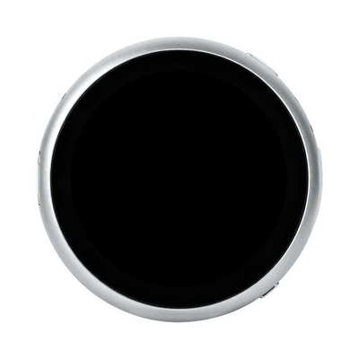
</p>

A live OBD2 dashboard for your motorcycle, on the round 1.85" touch screen of the
**Waveshare ESP32-S3-Touch-LCD-1.85B**. It talks to the bike's ECU through a cheap **Bluetooth LE ELM327
adapter** and shows what the engine reports across ten swipeable pages: RPM, speed, estimated gear,
coolant, battery voltage, throttle and load, fault codes, a fuel estimate and lean angle. It can also read
BLE tyre-pressure sensors. Every ride is logged to a microSD card, and a small script turns the logs into
an offline website with charts.

Your bike's numbers (rev range, gearbox, tank, tyre pressures, alert limits) live in a short **bike
profile** header. The dashboard ships with a generic profile and a complete, field-tested example for a
2022 Honda CB500X.

> **Informational only.** It doesn't replace the bike's instruments or warning lights. Mount it where it
> can't distract you, and don't operate it while riding.

<table align="center">
  <tr>
    <td align="center">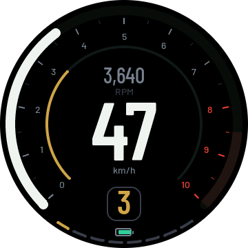<br>1 Ride</td>
    <td align="center">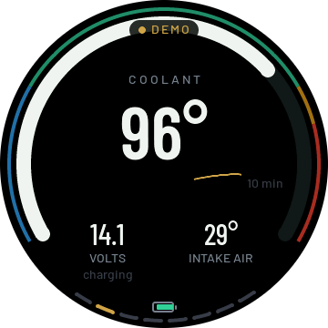<br>2 Engine</td>
  </tr>
  <tr>
    <td align="center">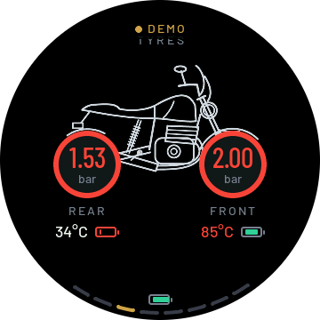<br>3 Tyres</td>
    <td align="center">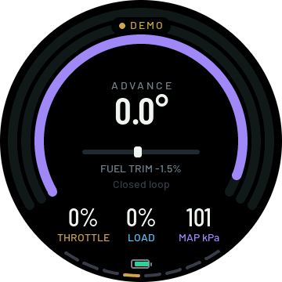<br>4 Performance</td>
  </tr>
  <tr>
    <td align="center">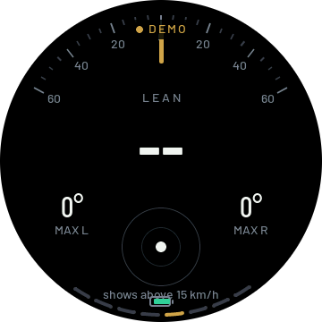<br>5 Lean &amp; G</td>
    <td align="center">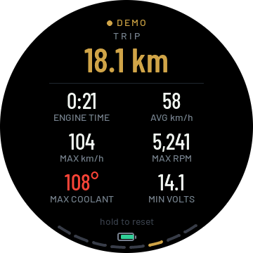<br>6 Trip</td>
  </tr>
  <tr>
    <td align="center">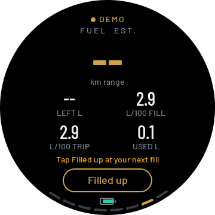<br>7 Fuel (est.)</td>
    <td align="center">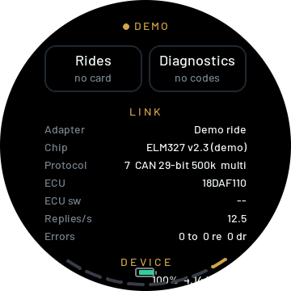<br>8 Status</td>
  </tr>
  <tr>
    <td align="center">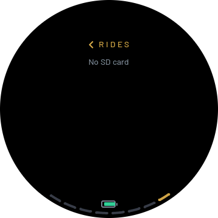<br>Rides (from Status)</td>
    <td align="center">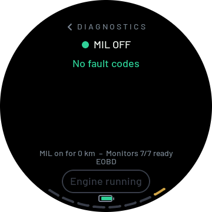<br>Diagnostics (from Status)</td>
  </tr>
</table>

*Screenshots straight from the board's framebuffer, in demo mode.*

## What you need

| Part | Notes |
|---|---|
| [Waveshare ESP32-S3-Touch-LCD-1.85B](https://www.waveshare.com/esp32-s3-touch-lcd-1.85b.htm) | The **B** version: 360×360 ST77916 round LCD, ESP32-S3R8, 16 MB flash, 8 MB PSRAM, IMU, RTC, battery gauge, speaker and microSD slot |
| A **BLE** ELM327 adapter | Field-tested: Vgate iCar Pro BLE / 2S (`18F0` service). Adapters with the `FFF0` or `FFE0` layouts (OBDLink CX, Veepeak, LELink, Konnwei and most "OBDII" BLE clones) are supported too. Classic-Bluetooth (SPP) and Wi-Fi adapters are **not** |
| The cable for your bike's diagnostic plug | Most bikes don't have the car-style 16-pin OBD2 socket: Honda and Kawasaki use a 6-pin plug, Yamaha 3- or 4-pin, KTM 6-pin, BMW 10-pin… Search for "<make> OBD2 adapter cable" |
| microSD card (optional) | FAT32. Holds the ride logs and the tyre-sensor settings. About 5 MB an hour of riding |
| 3.7 V LiPo cell (optional) | The board's 2-pin battery connector. Keeps the clock running with the bike off, and runs the board without USB power |
| BLE tyre sensors (optional) | Valve-cap or in-wheel sensors that broadcast their readings. See [docs/tyre-sensors.md](docs/tyre-sensors.md) |

**Will it work with my bike?** The bike's ECU must answer standard OBD2 (SAE J1979) requests. Bikes sold in
the EU since Euro 5 (2020/21) have to, and most use ISO 15765-4 CAN, which this was developed on. The ELM327
also speaks the older K-line protocols, so some earlier bikes work as well. Many pre-Euro 5 bikes only have
the maker's own diagnostics, and those won't answer. The quickest test is a phone app such as Car Scanner
or OBD Fusion with the same adapter. If it shows live RPM, this dashboard will too. Each ECU reports a
different set of values, and the pages show `--` for anything yours doesn't report.

## Quick start

1. **Install ESP-IDF 5.5** ([Espressif's guide](https://docs.espressif.com/projects/esp-idf/en/v5.5/esp32s3/get-started/)),
   then load it in your shell (`. $IDF_PATH/export.sh`).
2. **Build and flash.** The board starts in demo mode, so you can try every page on the desk:

   ```bash
   git clone https://github.com/Gnzlt/ESP32-S3-Touch-OBD2.git
   cd ESP32-S3-Touch-OBD2
   idf.py build
   idf.py -p <port> flash monitor      # e.g. /dev/cu.usbmodem1101, /dev/ttyACM0 or COM5; Ctrl+] exits
   ```
3. **Pick or make your bike profile**, then build and flash again:
   `idf.py menuconfig` → **OBD2 dashboard** → **Bike profile**. See [Configure your bike](#configure-your-bike).
4. **On the bike:** plug the adapter into the diagnostic port and turn the ignition on. **Close any phone app
   that is connected to the adapter**, because it takes one connection at a time. On the dashboard, swipe to **Status**
   (page 8) and switch **Demo mode** off. The board scans for the adapter, connects, and remembers it and its
   protocol for next time.

## Configure your bike

Everything bike-specific is in one header in [`main/bike/profiles/`](main/bike/profiles/):

```c
#define BIKE_NAME            "MY BIKE"      // boot splash
#define BIKE_RPM_MAX         12000.0f       // rev counter end
#define BIKE_RPM_RED         10500.0f       // red zone
#define BIKE_GEAR_RATIOS     {2.85f, 2.07f, 1.63f, 1.33f, 1.12f, 0.96f}   // optional
#define BIKE_GEAR_K          55.0f          // or: primary and final drive + rear tyre size
#define BIKE_DISPLACEMENT_L  0.89f          // fuel estimate
#define BIKE_TANK_L          18.0f          // range
#define BIKE_TYRE_FRONT_KPA  250.0f         // cold pressures: the tyre alert defaults
#define BIKE_TYRE_REAR_KPA   290.0f
```

(Illustrative numbers. Use your bike's.) Copy [`generic.h`](main/bike/profiles/generic.h) to
`main/bike/profiles/<your_bike>.h`, fill it in, and enter `<your_bike>` under **OBD2 dashboard → Bike
profile** in `idf.py menuconfig`. Coolant and voltage alert limits, the fuel model's efficiency and more
have sensible defaults you can override. **[docs/configure-your-bike.md](docs/configure-your-bike.md)**
explains every value: where to find your gear ratios, and how `tools/fit_gears.py` fits the gear estimate
to your bike from a logged ride. It also covers replacing the splash and Tyres-page artwork with a drawing
of your own bike.

A profile for your bike would be a welcome pull request.

## The pages

Swipe left and right, or use the board's **BOOT** button: press for the next page, double-press for the
previous one, hold for the page's long-press action. The split gauge on the bottom rim shows where you are.

| # | Page | What it shows |
|---|---|---|
| 1 | **Ride** | RPM around the rim with the red zone, speed in large digits, throttle on an inner arc, estimated gear |
| 2 | **Engine** | Coolant gauge with cold/normal/warm/hot zones and a 10-minute sparkline, battery voltage and charging state, intake air temperature |
| 3 | **Tyres** | A motorcycle whose wheels are the gauges: each tyre's pressure, temperature and sensor battery. Tap a wheel for its alerts, long-press to pair its sensor |
| 4 | **Performance** | Throttle, engine load and manifold pressure; ignition advance; short-term fuel trim; open/closed loop |
| 5 | **Lean & G** | Lean angle, max left and right, a G-ball with a trail (from 15 km/h) |
| 6 | **Trip** | Distance, engine time, average and max speed, max RPM and coolant, min voltage. Hold to reset |
| 7 | **Fuel (est.)** | Fuel used and range since the last fill-up, L/100 km. **Filled up** records a fill-up, which calibrates the estimate |
| 8 | **Status** | Adapter, ECU, protocol, replies per second, board battery and temperatures, SD card; settings (brightness, beeps, alerts, logging, tyre sensors, pressure unit, demo mode, battery saver) |

From Status, **Rides** lists the logged rides with their stats. **Diagnostics** shows the MIL, stored
and pending fault codes with descriptions, readiness monitors, and **Clear codes** (engine off).

On top of the pages:
- **Alerts:** a full-screen pulse and beeps for an overheating engine, a battery that isn't charging or is
  over-charged, a new fault code, a tyre losing pressure, or the board itself getting too hot or running
  flat. Tap to dismiss.
- **Connection pill:** searching, connecting, ignition off, connected.
- **Parked screen:** after 2 minutes without the ECU, the screen dims to the bike and the board's
  battery level.
- **Battery saver:** a dim status-only screen for a board in a tank bag. It switches on by itself when the
  board's battery runs low or the board gets hot.

**Lean angle** needs no calibration and works however the board is mounted. It's worked out from the
turn itself (speed × yaw rate), fused with the gyro, and the board learns which way is up as you ride. If
it reads the wrong way round, flip `MOTION_FLIP` in `main/sensor_task.c`. **The gear** is estimated from
RPM ÷ speed, because OBD2 has no gear PID. **Fuel** is estimated from the engine load (most bikes report no
fuel rate or level), and each fill-up you enter calibrates it.

## Ride logs and the ride website

With a microSD card in, every ride gets its own folder: 5 samples a second of every value
(`trip.csv`), the events (`events.csv`), the ride's totals (`ride.json`), and every byte exchanged with
the adapter (`obd_raw.log`). With the board on the USB cable:

```bash
pip install pyserial
python3 tools/pull_logs.py <port>        # copies the rides to logs/ and builds site/
open site/index.html                     # or just double-click it: no server needed
```

The website has an overview of every ride and fill-up, and a page per ride with zoomable charts of
everything logged. [docs/ride-logs.md](docs/ride-logs.md) describes each file and column.

## menuconfig options

`idf.py menuconfig` → **OBD2 dashboard**:

| Option | Default | |
|---|---|---|
| `DASH_BIKE_PROFILE` | `generic` | The bike profile: a header in `main/bike/profiles/`, without `.h` |
| `DASH_DEMO_DEFAULT` | on | Start in demo mode on a fresh board. After that, the Status page switch is saved |
| `DASH_ADAPTER_NAME` | empty | Only accept an adapter whose name contains this, for example `IOS-Vlink` |
| `DASH_LOG_DEMO` | off | Write ride logs in demo mode too |
| `DASH_FORMAT_SD_ON_BOOT` | off | Formats the card once, on the first boot of that build. **Erases it** |
| `DASH_SCREENSHOTS` | off | Prints each page over serial at boot. `tools/grab_screens.py <port> <dir>` saves PNGs |
| `DASH_SCREENSHOT_DELAY_S` | 0 | Seconds before the first screenshot (160 catches the demo bike on the move) |
| `DASH_AUTOTOUR` | off | Swipes through the pages by itself |
| `DASH_PERF_MONITOR` | off | LVGL's FPS/CPU overlay |

**Demo mode** needs no adapter. It plays a synthetic five-minute ride geared to your bike profile, and stages
an overheat, a fault code and an engine stop each loop, so every alert and the clear-codes flow can be tried
on the desk.

## Tests

The protocol core, the alerts, gear, trip, fuel, lean and tyre-sensor logic are plain C and run on your
computer. ELM327 transcripts in `test/fixtures/` are played back through the real session:

```bash
cmake -S test/host -B build-host -G Ninja && cmake --build build-host && ./build-host/host_tests
python3 -m unittest tools/test_build_site.py
```

## Documentation

- [Configure your bike](docs/configure-your-bike.md): the bike profile, gear fitting, artwork
- [Ride logs](docs/ride-logs.md): the files on the card, downloading, the website, fuel calibration
- [Tyre sensors](docs/tyre-sensors.md): supported formats, pairing, limits, `tpms.cfg`
- [How it works](docs/how-it-works.md): the code's layout, the BLE link and ELM327 session, polling,
  memory, the board's power and heat protection
- [Troubleshooting](docs/troubleshooting.md)

## Credits

- The board support package in `components/esp32_s3_touch_lcd_1_85b` is Waveshare's (Apache-2.0), with
  the changes listed in its README.
- Fonts: [Barlow](https://github.com/jpt/barlow) by Jeremy Tribby (SIL OFL 1.1), converted with
  `lv_font_conv`. UI: [LVGL](https://lvgl.io) 9 (MIT).
- The tyre-sensor formats were learned from these open-source projects. No code was copied from them, and the
  GPL and unlicensed ones were read for facts only:
  aveshev/TPMS-advanced-NE (Apache-2.0), bkbilly/tpms_ble (MIT), ra6070/BLE-TPMS (MIT),
  anufryieu/tesla-tpms-ble (MIT), cunzulatu/Tesla_BLE_TPMS (MIT), andi38/TPMS, Zen3515/djtpms (Apache-2.0,
  the DJTPMS CRC8 and its captures), 8bitmcu/ESPHome_BLE_TPMS (GPL-3.0), AzNdevil/DJTPMS (no licence),
  theengs/decoder (GPL-3.0).

## License

[MIT](LICENSE), except the vendored BSP (Apache-2.0) and the Barlow fonts (OFL 1.1).
